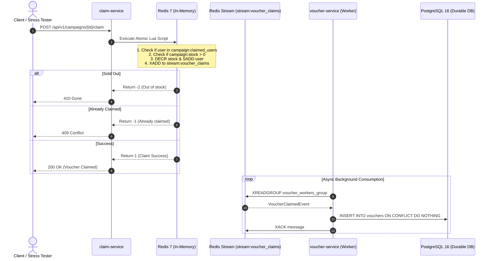

# High-Throughput Voucher Flash Sale System

A production-grade, distributed **Voucher Flash Sale Engine** designed for hackathons and high-concurrency workloads. Engineered to guarantee **zero overselling**, sub-millisecond stock deductions, per-user idempotency, and asynchronous eventual consistency.

---

## 🏗 Architecture Principles

### 1. Microservices Architecture
The platform is decoupled into three specialized microservices:
- **`campaign-service`** (`:8081`): Manages flash sale campaigns, lifecycle, schedules, and pre-warms inventory into Redis.
- **`claim-service`** (`:8082`): Ultra-low-latency flash sale claim engine. Executes atomic stock deduction and duplicate detection in Redis via Lua scripts and publishes events to Redis Streams.
- **`voucher-service`** (`:8083`): Asynchronous background stream consumer and wallet manager. Consumes claim events from Redis Streams, batch-persists records into PostgreSQL, and manages voucher redemption (`CLAIMED` -> `REDEEMED`).

### 2. Clean Architecture
Each microservice strictly follows Clean Architecture (Ports and Adapters):
```
service/
├── cmd/server/main.go            # Entrypoint & DI Wiring
└── internal/
    ├── domain/                   # Entities, Value Objects, Domain Interfaces
    ├── usecase/                  # Business Logic & Workflows
    ├── repository/               # Secondary Adapters (Postgres, Redis Lua)
    ├── delivery/
    │   ├── http/                 # Primary Adapters: HTTP Handlers & Routers
    │   └── consumer/             # Primary Adapters: Redis Stream Consumers
    └── config/                   # Environment & Configuration Loaders
```

### 3. Trunk-Based Development (TBD)
- **Single Source of Truth**: Active development occurs against `main`.
- **Automated CI Pipeline**: `.github/workflows/ci.yml` enforces format checks (`gofmt`), static analysis (`go vet`), unit tests with race detection (`go test -race`), and multi-stage Docker builds.
- **Standardized PR Template**: `.github/pull_request_template.md` guides fast, atomic pull requests with zero breaking migrations.

---

## ⚡ Concurrency & Anti-Overselling Design



---

## 🚀 Quick Start

### Prerequisites
- [Go 1.22+](https://go.dev/)
- [Docker & Docker Compose](https://www.docker.com/)

### 1. Run Everything with Docker Compose
```bash
make docker-up
```
This spins up:
- PostgreSQL 16 (Port `5432`)
- Redis 7 (Port `6379`)
- Campaign Service (Port `8081`)
- Claim Service (Port `8082`)
- Voucher Service (Port `8083`)

### 2. Verify Service Health
```bash
curl http://localhost:8081/healthz
curl http://localhost:8082/healthz
curl http://localhost:8083/healthz
```

### 3. Run Concurrency Stress Test
Run the automated load test simulating 300 users firing 600 concurrent requests against a 50-stock voucher flash sale:
```bash
make load-test
```

### 4. Run Unit Tests Locally
```bash
make test
```

---

## 📡 API Endpoints

### Campaign Service (`:8081`)
| Method | Endpoint | Description |
|---|---|---|
| `POST` | `/api/v1/campaigns` | Create campaign & pre-warm stock in Redis |
| `GET` | `/api/v1/campaigns/{id}` | Fetch campaign details & live stock |
| `GET` | `/api/v1/campaigns` | List all campaigns |

### Claim Service (`:8082`)
| Method | Endpoint | Description |
|---|---|---|
| `POST` | `/api/v1/campaigns/{id}/claim` | High-concurrency atomic voucher claim |
| `GET` | `/api/v1/campaigns/{id}/stock` | Query real-time remaining inventory |

### Voucher Service (`:8083`)
| Method | Endpoint | Description |
|---|---|---|
| `GET` | `/api/v1/users/{user_id}/vouchers` | List all vouchers claimed by a user |
| `POST` | `/api/v1/vouchers/{code}/redeem` | Redeem a voucher |
